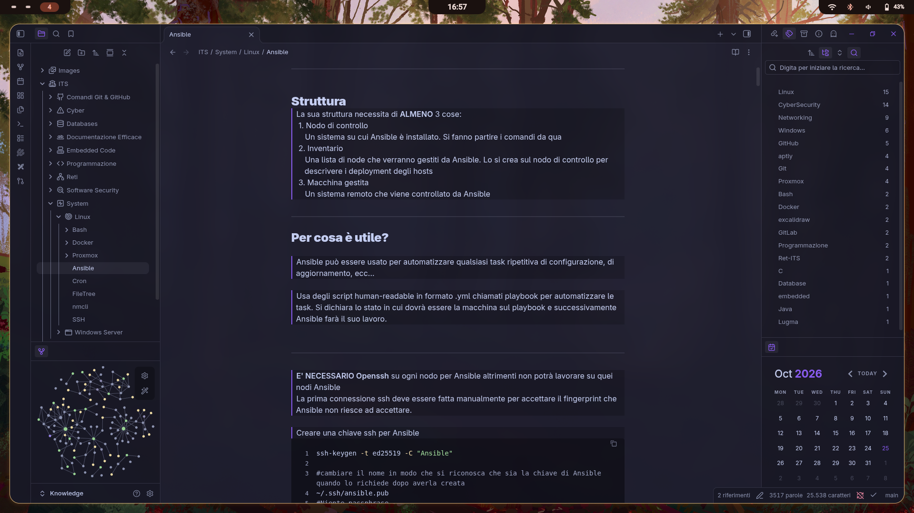

# **Benvenuto nella mia Documentazione**

> Qui raccolgo appunti, configurazioni e guide rapide riguardanti il mio percorso di studi e i miei progetti personali.

> [!NOTE] La documentazione è in continuo aggiornamento e potrebbe non essere sempre al passo con quella su GitHub

---

## **Aree Tematiche**

> Utilizzo Obsidian come applicazione di note taking e per mantenere il mio ambiente pulito ho deciso di organizzare il vault in 2 cartelle principali per il momento:

- **ITS**
  In questa cartella tengo tutti gli appunti presi durante il mio percorso presso ITS Digital Academy Mario Volpato di Verona.

- **Personal-Experiences**
  Mentre qua ci sono appunti presi da autodidatta tra vari videocorsi ed altri miniprogetti che ho svolto per conto mio.

---

## **Link Utili**

# **[Profilo Github](https://github.com/Penz26)**

<iframe

src="https://github.com/Penz26"

width="100%"

height="600px"

style="border: 1px solid #ddd; border-radius: 8px;">

</iframe>

# **[Sito Personale self hostato](https://manuelbernardelli.it)**

<iframe
	src="https://manuelbernardelli.it"
	width="100%"
	height="600px"
	style="border: 1px solid #ddd; border-radius: 8px;">
</iframe>